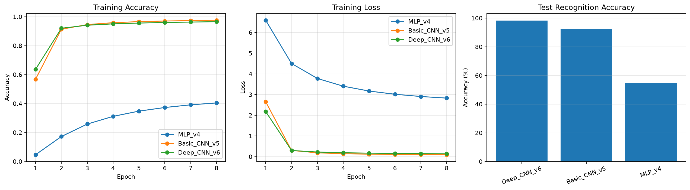

# DIT5411 — Traditional Chinese Handwriting Recognition

This machine learning project compares three TensorFlow models on a 13,065-class classification task. Given an image of one handwritten Traditional Chinese character, each model predicts its character class. **Deep CNN achieved the highest top-1 test accuracy (98.25%)**, followed by Basic CNN (92.26%) and MLP (54.41%).

## Dataset and split

The full Traditional Chinese Handwriting Dataset contains 684,677 images across 13,065 character classes. Within each character folder, the notebook sorts images by filename, takes the first 40 for training, and reserves the remaining images for testing. The 43 classes with fewer than 40 images contribute all their samples to training.

| Split | Original images | Character classes represented |
|---|---:|---:|
| Training | 522,127 | 13,065 |
| Testing | 162,550 | 13,022 |

The notebook decodes each image, converts it to grayscale, resizes it to 64 × 64 pixels, and inverts the normalized intensity so that dark strokes have values close to 1 and the white background is close to 0.

## Training data augmentation

Each epoch contains exactly **200 training entries per character**, or **2,613,000 entries** in total. Every training original appears once without augmentation. The pipeline cycles through originals from the same class to fill the remaining entries and applies random transformations as it loads each batch.

| Transformation | Setting |
|---|---|
| Rotation | Up to 10° in either direction |
| Horizontal shear | Keras shear factor of 0.08 |
| Zoom | Up to 8% along each axis |
| Translation | Up to 4% of image height and width |

Flips are excluded to preserve character orientation. Test images receive only the deterministic preprocessing described above.

## Model architectures

All models accept a 64 × 64 × 1 image and use a final dense layer with **13,065 softmax outputs**. All convolution kernels are 3 × 3.

| Model | Architecture before the softmax classifier |
|---|---|
| MLP_v4 | Flatten → Dense(512, ReLU) → Dropout(0.30) → Dense(256, ReLU) |
| Basic_CNN_v5 | Three convolution blocks with 32, 64 and 128 filters, each followed by ReLU and max pooling → Flatten → Dense(256) → LeakyReLU(0.1) |
| Deep_CNN_v6 | Three blocks with 32, 64 and 128 filters. Each block contains two convolutions with batch normalization and ReLU, followed by max pooling. A final 256-filter convolution is followed by LeakyReLU(0.1), 2 × 2 average pooling, Flatten, Dense(256), LeakyReLU(0.1) and Dropout(0.35). |

## Training and evaluation

Each model trained for eight epochs with a batch size of 32, the Adam optimizer, an initial learning rate of 0.0003, global gradient clipping at norm 1.0, and sparse categorical cross-entropy. The learning-rate scheduler monitored training loss. For each architecture, the notebook saved the checkpoint with the lowest training loss and evaluated it on the same test set. Top-1 accuracy is the fraction of images for which the highest-scoring class matches the label.

| Model | Parameters | Training accuracy | Training loss | Test accuracy | Test loss |
|---|---:|---:|---:|---:|---:|
| MLP_v4 | 5,586,697 | 40.41% | 2.8289 | 54.41% | 1.9959 |
| Basic_CNN_v5 | 5,547,785 | 97.53% | 0.0923 | 92.26% | 0.6053 |
| Deep_CNN_v6 | 4,989,481 | 96.52% | 0.1364 | **98.25%** | **0.0931** |

Training metrics were recorded during the selected epoch with augmentation enabled. Test metrics were measured using the saved weights on unaugmented images in inference mode.

### Exact-duplicate audit

Training and test file paths were disjoint. A separate comparison of image dimensions and decoded grayscale pixels found that **6,212 of the 162,550 test images (3.82%)** exactly matched a training image. The table reports results on the full assignment-specified split, including those matches. The split was defined by filename within each character class. Performance on previously unseen writers was not measured separately.

## Reproducing the experiment

1. Set up WSL2 Ubuntu, Python 3.12, TensorFlow 2.20.0 with GPU support, and JupyterLab. See the [environment setup guide](SETUP_EN.md).
2. Download and extract the [full dataset](https://github.com/chenkenanalytic/handwritting_data_all) so that the character folders are directly under `~/DIT5411/dataset/cleaned_data/`.
3. Open the project's handwriting recognition notebook in JupyterLab. Run Steps 1–8 to prepare the data, then Steps 9–15 to define and train the models.
4. Run Steps 16–18 to evaluate the saved checkpoints and export the comparison table, figure and Markdown results. The notebook writes these files under `~/DIT5411/results_diagnostic_v4/`.

## References and attribution

- [AI . FREE Team — Traditional Chinese Handwriting Dataset](https://github.com/AI-FREE-Team/Traditional-Chinese-Handwriting-Dataset). The team adapted the dataset from **STUST EECS_Chinese MNIST** and distributes it under **CC BY-NC-SA 4.0**.
- [Full 13,065-character dataset distribution](https://github.com/chenkenanalytic/handwritting_data_all)
- [Keras image augmentation layers](https://keras.io/api/layers/preprocessing_layers/image_augmentation/)
- [TensorFlow installation guide](https://www.tensorflow.org/install/pip)
- [Introduction to OpenCV — augmentation reference supplied in the assignment](https://github.com/darshitajain/Introduction-to-OpenCV)
